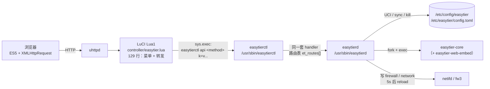

[English](README_EN.md) | 简体中文

[](LICENSE)
[](https://openwrt.org)
[](https://deepwiki.com/EasyTier/luci-app-easytier)

OpenWrt LuCI 界面，用于管理 [EasyTier](https://github.com/EasyTier/EasyTier) —— 一个简单、安全、去中心化的内网穿透 VPN 组网方案。

> **当前 `main` 分支是 C 后端重写版。** 进程守护、配置读写、防火墙编排、下载安装、状态采集全部由 C 实现
> （`/usr/sbin/easytierd`、`/usr/sbin/easytierctl`），LuCI 侧只保留一层 129 行的极薄转发壳。
> 旧的 Lua + Shell 实现在分支 [`legacy/lua`](../../tree/legacy/lua)，两者的逐项对照见 [docs/C-PORT.md](docs/C-PORT.md)。

## UI 预览


## ✨ 特性

- 🎨 现代化 UI 设计，支持亮色/暗色主题自动切换
- 📱 完美适配移动端和桌面端
- 🌍 完整的中文/英文国际化支持
- 📊 实时流量监控和网卡状态显示
- 🔄 实时显示性能占用和版本信息
- 📦 支持压缩包和二进制文件上传
- 🔧 灵活的配置管理和备份恢复
- ⚙️ **C 后端**：不再靠 fork `top`/`awk`/`df` 采集状态，状态页只读 `/proc` 与 `sysfs`
- ⬇️ **异步下载**：下载在后台进行、可随时取消、安装原子替换，不再卡住整个页面

## 🏗️ 架构说明

两个进程 + 一层极薄转发壳，业务逻辑只有一份：



```
浏览器
  └─ uhttpd ──> LuCI（Lua1，只有菜单注册与请求转发）
                   └─ sys.exec("easytierctl api <method> ...")
                        └─ easytierd 的 handler（src/api/*.c，共 28 条路由）
                             ├─ 读/写 UCI（libuci）
                             ├─ 扫描 /proc、读 sysfs（状态、进程、CPU、内存）
                             ├─ fork/exec easytier-core / easytier-web-embed
                             └─ 写 firewall / network 配置并延迟 reload
```

一次点击的完整路径（以保存配置为例）：

1. 浏览器把表单 POST 到 `/cgi-bin/luci/admin/vpn/easytier/config_save`；
2. `easytier.lua` 不解析业务字段，直接把请求体/表单拼成 `key=value`，调用 `easytierctl api config_save ...`；
3. `easytierctl` 在进程内调用 `et_api_config_save()`（与 ubus、daemon 内部调用是同一套 handler）；
4. handler 按 schema 校验并写回 `/etc/config/easytier`；
5. 需要重启时，由 `toggle_*` / `restart_service` 这类接口把动作丢给脱离会话的子进程，接口立刻返回。

设计上的关键点：

- **一条命令行的唯一事实来源是 `src/lib/etd_schema.c` 的 `et_schema[]`（120 条）**，它同时驱动 UCI 读取、argv 拼装、表单渲染和 `/schema` 接口；
- **路由名与原 Lua 端点逐字一致**（`api_status`、`get_log`、`download_easytier` …），所以旧前端模板一行不改就能用；
- **进程监督从 procd 移到 daemon 内**：`easytierd service run` 自己负责 respawn（1 小时窗口内最多 20 次、间隔 5 秒）、60 秒日志轮转、checkip 看门狗与信号级联；
- **ubus 对象尚未实现**，当前所有调用都走 `easytierctl exec` 这条路径（见 [docs/C-PORT.md](docs/C-PORT.md#5-尚未完成与待验证)）。

## 📦 两个包

| 包 | 内容 | 作用 | 依赖 |
| --- | --- | --- | --- |
| `easytierd` | `/usr/sbin/easytierd`、`/usr/sbin/easytierctl` | **C 后端**：进程守护、配置模型、防火墙/接口编排、状态采集、日志、上传下载安装、i18n 字典加载 | `libubox` `libubus` `libuci` `libblobmsg-json` `libjson-c` |
| `luci-app-easytier` | `luasrc/controller/easytier.lua`、6 个 HTM 模板、`/etc/init.d/easytier`（24 行）、UCI 默认配置、rpcd ACL、i18n JSON | **UI 与桥接层**：菜单、页面模板、把请求转发给 `easytierctl` | `+kmod-tun` `+luci-compat` **`+easytierd`** |

`luci-app-easytier` 强依赖 `easytierd`：少了它界面能打开但所有接口都会失败。包管理器会解析这个依赖，
但如果你是把 ipk 手动 `scp` 上去再逐个装，请按 `easytierd` → （可选的 `easytier` 核心包）→ `luci-app-easytier` 的顺序。

`easytier` / `easytier-noweb` 仍然是 EasyTier 官方二进制的打包（`/usr/bin/easytier-core`、`easytier-cli`、
可选 `easytier-web-embed`），与本插件解耦：不装它们也可以只装 LuCI 再手动上传二进制。

## 📋 兼容性

### OpenWrt 版本

- ✅ OpenWrt 18.06 / 18.08（LuCI Lua1，无 menu.d JSON，因此保留 Lua 菜单）
- ✅ OpenWrt 19.x ~ 26.x
- ✅ 支持 IPK（22.03.x 等 opkg 固件）与 APK（SNAPSHOT 等 apk 固件）包格式

### 架构支持

- ARM: aarch64, armv7, arm
- MIPS: mips, mipsel
- x86: x86_64（32 位 x86 不提供下载包，`download_easytier` 会直接报错）

### 技术栈约束（不可协商）

- 前端：HTML + CSS + **ES5 JavaScript**（禁止 `let`/`const`/箭头函数/`fetch`/框架/构建工具）
- LuCI：**Lua1**（`luci.controller` / `luci.http` / `luci.sys`；禁止 LuCI JS 框架）
- 后端：C11 + POSIX，`-Wall -Wextra -Werror` 零告警；依赖 `libuci`、`json-c`

## 🚀 安装

### 方式一：预编译包

```bash
# 1) 先装 C 后端（必需，luci-app-easytier 依赖它）
opkg install /tmp/easytierd_*.ipk

# 2) 可选：装核心二进制（或稍后在"上传程序"页手动上传）
opkg install /tmp/easytier_*.ipk          # 含 easytier-web-embed
# opkg install /tmp/easytier-noweb_*.ipk  # 不含自建控制台，省空间

# 3) 装界面
opkg install /tmp/luci-app-easytier_*.ipk
```

APK 固件把 `opkg install` 换成 `apk add --allow-untrusted`。安装后刷新浏览器或重新登录 LuCI。

> ⚠️ 当前 `.github/workflows/build.yml` 只构建 `easytier` / `easytier-noweb` / `luci-app-easytier`，
> 还没有把 `easytierd` 加进 `PACKAGES`。在 CI 补齐之前，`easytierd` 需要自己用
> `scripts/cloud/build.sh` 产出（见 [DEVELOPMENT.md](DEVELOPMENT.md#云端构建纪律必须遵守)）。

### 方式二：自行构建

本地不编译，一律在 CNB 云原生开发环境里构建 ipk：

```bash
scripts/cloud/start.sh          # 拉起云环境
scripts/cloud/setup.sh          # 装底座（幂等，冷启动约 60s）
scripts/cloud/build.sh --luci   # OpenWrt SDK 出 easytierd + luci-app-easytier 的 ipk
```

细节与常见坑见 [DEVELOPMENT.md](DEVELOPMENT.md)。

### 依赖

- `kmod-tun` —— TUN/TAP 内核模块（必需，`luci-app-easytier` 已声明依赖）
- `luci-compat` —— LuCI 兼容层
- `libuci` / `json-c` —— `easytierd` 运行时依赖（由包管理器自动带上）

```bash
opkg update
opkg install kmod-tun
```

## 🔧 使用说明

### 首次配置

1. 进入 **VPN → EasyTier**；
2. 在 **上传程序** 页上传 `easytier-core`、`easytier-cli`（以及可选的 `easytier-web-embed`），
   或者直接装 `easytier.ipk` / `easytier.apk`；
   - 支持单个文件，也支持 `.zip` / `.tar.gz` / `.tgz` / `.tar` 压缩包（官方 zip 里的 `easytier-linux-<arch>/` 会被自动摊平）；
   - 也可以在页面里"在线下载"，选版本后由后台下载并安装；
3. 在 **EasyTier Core** 页配置网络名称、密钥、节点等参数；
4. 打开"启用"并保存，服务随即启动。

### 配置方式

三种启动方式（`etcmd`）：

1. **默认**（`etcmd`）—— 由界面上的命令行参数生成 `easytier-core` 的 argv；
2. **配置文件**（`config`）—— 使用 `/etc/easytier/config.toml`，启动前会跑 `--check-config`；
3. **Web 配置**（`web`）—— 用 `--machine-id` + `-w <完整 URL>` 从 EasyTier 官方配置服务拉配置。

### 功能页面

- **状态** —— 运行状态、版本（本地 vs 最新）、CPU/内存占用、连接信息分区（node/peer/route/…）、实时流量
- **EasyTier Core** —— 核心参数表单（三个分页：基本设置 / 高级设置 / Web 控制台）
- **EasyTier Web** —— 自建控制台（`easytier-web-embed`）参数与状态
- **日志** —— 运行日志，支持级别过滤、清空
- **上传程序** —— 上传 / 在线下载 / 查看磁盘空间

## 🔄 与旧版（Lua + Shell）的差异

| 方面 | 旧版（`legacy/lua`） | 现在（C 后端） |
| --- | --- | --- |
| 状态采集 | 一屏状态要 fork `pgrep`×2、`top`×2、`pidof`×4、`awk`×4、`df`×2、`ip`×4、`ifconfig`，单次请求数秒 | 读 `/proc/<pid>/stat`、`/proc/net/if_inet6`、`/sys/class/net/*`、`statvfs`；只有版本探测、`easytier-cli` 分区查询、GitHub tag 与 `ifconfig`/`ip` 回退才起子进程 |
| 在线下载 | 同步阻塞 HTTP 响应（最长 5×300 秒），只能在换镜像之间取消 | 后台双 fork 执行，接口立刻返回；进度写 `/tmp/easytier_download_progress`；取消延迟约 200ms |
| 安装二进制 | 上传用 `mv`（跨文件系统时退化为拷贝），在线下载安装直接 `cp` 覆盖目标；中途失败可能留下半个二进制 | 先写 `<目标>.etnew` 再 `rename`，要么旧文件要么完整新文件 |
| 配置表单 | LuCI CBI（`model/cbi/*.lua`，599 行） | C 按 `et_schema[]` 渲染 HTML（`config_render`），Lua 只取 stdout 输出；**CBI 页面已移除** |
| 进程监督 | procd（threshold 3600 / timeout 5 / retry 20）+ 一段写到 `/tmp/easytier_check` 的 shell 看门狗 | `easytierd service run` 自己实现同样的 respawn、日志轮转、看门狗与信号处理，不落脚本文件 |
| 日志轮转 | v2.6.4 之前用 `tmp + rename`，导致 fd 指向已删 inode、日志不再增长 | 沿用 v2.6.4 的修复：**原地截断**保留最后 500 行（>5120KB 时，每 60 秒检查） |
| 上传校验 | 无来源路径校验 | `upload_binary` 只接受绝对路径的普通文件，且拒绝 `/bin` `/sbin` `/usr` `/lib` `/etc` `/dev` `/proc` `/sys` `/var/lib` `/var/run` 前缀 |
| i18n | 全部走 LuCI `.lmo` | Lua 侧仍用 `.lmo`；**C 渲染的表单文案**改由 `tools/i18n_build.py` 把 po 转成 JSON 字典，运行时查表 |

几处容易踩到的细节（都是刻意的）：

- `default_protocol` 为空时**不输出** `--default-protocol`（旧实现会输出裸旗标，`easytier-core` 因缺参数报错）；
- 未知的 `etcmd` 值按默认模式处理（旧实现会拼出空命令）；
- `vpn_portal` 只接受 `wg://host:port`；2.6.4 的 `wg://host:port/cidr` 写法与缺私钥的情况会被跳过并写日志说明；
- 门户私钥通过环境变量 `ET_VPN_PORTAL_PRIVATE_KEY` 下发给 core，不出现在命令行里（状态页会展示命令行）。

完整的模块映射与逐条差异见 [docs/C-PORT.md](docs/C-PORT.md)。

## ⬆️ 从旧版升级

1. 直接覆盖安装即可：`/etc/config/easytier` 与 `/etc/easytier/` 都在 `conffiles` 里，
   升级不会覆盖你的配置；`prerm` 还会把两份配置备份到 `/tmp/easytier_backup`、`/tmp/et_config_backup`，`postinst` 自动恢复。
2. **先装 `easytierd` 再装 `luci-app-easytier`**，否则界面会因为找不到 `easytierctl` 而所有接口报错。
3. 首次启动会补齐必要默认值：`web_enabled`、`easytierbin`、`webbin` 缺失时会被写回配置（由 daemon 启动路径负责）。
   注意区分两类"默认值"：schema 里的 61 条 `.def` **不会**因为启动就被写进 UCI；
   而表单里显示的初值（`listenermode=ON`、`tcp_port=11010` 等）会在你**点保存**时落库，因为它们与当前 UCI 值不同。
4. 旧版遗留的 `/usr/share/easytier/{download,firewall,utils}.sh` 仍在包里，但已无任何代码引用；
   它们不影响运行，可以忽略（`easytierd` 不调用任何 shell 辅助脚本）。
5. 升级后建议进"状态"页确认版本缓存已刷新（上传/下载安装成功后会自动清 `/tmp/easytier.tag`、`/tmp/easytierweb.tag`），
   必要时手动点一次"清除版本缓存"。

## 🐛 故障排除

### 界面能打开但所有操作失败

`easytierd` 没装或没执行权限：

```bash
ls -l /usr/sbin/easytierd /usr/sbin/easytierctl
easytierctl doctor      # 环境自检：UCI、二进制、架构、外部工具、磁盘、进程
```

### 单个接口想看原始返回

```bash
easytierctl api api_status
easytierctl api get_tun_info ifname=tun0
easytierctl api config_save network_name=mynet network_secret=secret
/etc/init.d/easytier restart        # 等价于 easytierd service restart
```

### 安装后界面不显示

```bash
rm -rf /tmp/luci-indexcache /tmp/luci-modulecache
# 重新登录 LuCI
```

### 服务起不来

```bash
/etc/init.d/easytier status   # 0=运行中
tail -n 100 /tmp/easytier.log
tail -n 100 /tmp/easytierweb.log
```

日志里会直接写明原因：程序缺失/架构不符、`unzip` 缺失导致无法解压、`config.toml` 校验失败
（2.7.0 起 `[vpn_portal_config] client_cidr` 与 `[flags]` 未知键都会导致解析失败）、
端口被占用、TUN 不可用等。

### 配置文件冲突

升级时若提示配置文件冲突，旧配置会保留，新配置保存为 `/etc/config/easytier-opkg`，可以忽略。

## 🛠️ 开发

- 贡献者指南（目录结构、schema 唯一事实来源、编码规范、云端构建、测试）：[DEVELOPMENT.md](DEVELOPMENT.md)
- 移植档案（C 版与 Lua 版的模块映射、行为差异、未完成项）：[docs/C-PORT.md](docs/C-PORT.md)
- 测试手册（三层验证与真机前清单）：[docs/TESTING.md](docs/TESTING.md)

铁律：**本地不编译、不跑测试**，所有编译与测试都在 CNB 云原生环境里通过 `scripts/cloud/*` 完成。

## 📄 许可证

本项目采用 [Apache License 2.0](LICENSE) 许可证。

## 🔗 相关链接

- [EasyTier 官方仓库](https://github.com/EasyTier/EasyTier)
- [EasyTier 官方文档](https://easytier.cn)
- [OpenWrt 官网](https://openwrt.org)

## 🤝 贡献

欢迎提交 Issue 和 Pull Request！
