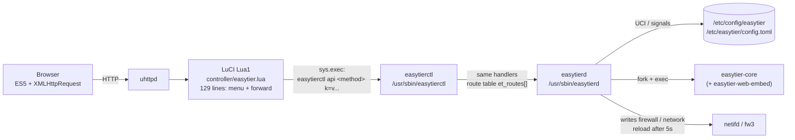

English | [简体中文](README.md)

[](LICENSE)
[](https://openwrt.org)
[](https://deepwiki.com/EasyTier/luci-app-easytier)

OpenWrt LuCI web interface for managing [EasyTier](https://github.com/EasyTier/EasyTier) - a simple, secure, and decentralized VPN networking solution.

> **The `main` branch is the C-backend rewrite.** Process supervision, configuration handling, firewall
> orchestration, binary download/install and status collection are all implemented in C
> (`/usr/sbin/easytierd`, `/usr/sbin/easytierctl`); LuCI keeps only a 129-line forwarding shell.
> The old Lua + Shell implementation lives in [`legacy/lua`](../../tree/legacy/lua); see
> [docs/C-PORT.md](docs/C-PORT.md) for the module-by-module comparison.

## UI Preview


## ✨ Features

- 🎨 Modern UI design with automatic light/dark theme switching
- 📱 Perfect adaptation for mobile and desktop devices
- 🌍 Full Chinese/English internationalization support
- 📊 Real-time traffic monitoring and network interface status display
- 🔄 Real-time performance metrics and version information
- 📦 Support for compressed packages and binary file uploads
- 🔧 Flexible configuration management with backup and restore
- ⚙️ **C backend**: the status page reads `/proc` and `sysfs` instead of forking `top`/`awk`/`df`
- ⬇️ **Async download**: runs in the background, cancellable at any time, installed atomically

## 🏗️ Architecture

Two processes plus one thin forwarding shell; business logic exists exactly once:



```
Browser
  └─ uhttpd ──> LuCI (Lua1: menu registration and request forwarding only)
                   └─ sys.exec("easytierctl api <method> ...")
                        └─ easytierd handlers (src/api/*.c, 28 routes)
                             ├─ read/write UCI (libuci)
                             ├─ scan /proc, read sysfs (status, processes, CPU, memory)
                             ├─ fork/exec easytier-core / easytier-web-embed
                             └─ write firewall / network config, then delayed reload
```

Path of a single click (saving the configuration):

1. the browser POSTs the form to `/cgi-bin/luci/admin/vpn/easytier/config_save`;
2. `easytier.lua` parses no business fields; it turns the request into `key=value` pairs and calls
   `easytierctl api config_save ...`;
3. `easytierctl` invokes `et_api_config_save()` in-process (the same handler used by ubus and by the daemon);
4. the handler validates against the schema and writes `/etc/config/easytier`;
5. actions that need a restart are dispatched to a detached child process, so the HTTP call returns immediately.

Key design points:

- **Single source of truth for a command line is `et_schema[]` (120 entries) in `src/lib/etd_schema.c`**;
  it drives UCI loading, argv generation, form rendering and the `/schema` endpoint;
- **route names are byte-identical to the old Lua endpoints** (`api_status`, `get_log`, `download_easytier`, …),
  so the existing page templates work unchanged;
- **supervision moved from procd into the daemon**: `easytierd service run` handles respawn
  (max 20 failures per hour, 5s apart), 60-second log rotation, the checkip watchdog and signal cascade;
- **no ubus object yet** — every call currently goes through the `easytierctl exec` path
  (see [docs/C-PORT.md](docs/C-PORT.md)).

## 📦 The Two Packages

| Package | Contents | Role | Depends |
| --- | --- | --- | --- |
| `easytierd` | `/usr/sbin/easytierd`, `/usr/sbin/easytierctl` | **C backend**: supervision, config model, firewall/interface orchestration, status, logs, upload/download/install, i18n dictionary | `libubox` `libubus` `libuci` `libblobmsg-json` `libjson-c` |
| `luci-app-easytier` | `luasrc/controller/easytier.lua`, 6 HTM templates, `/etc/init.d/easytier` (24 lines), UCI defaults, rpcd ACL, i18n JSON | **UI and bridge**: menu, templates, forward requests to `easytierctl` | `+kmod-tun` `+luci-compat` **`+easytierd`** |

`luci-app-easytier` hard-depends on `easytierd`: without it the pages load but every endpoint fails. The package
manager resolves this dependency; if you `scp` the ipks and install them one by one, use the order
`easytierd` → (optional core package) → `luci-app-easytier`.

`easytier` / `easytier-noweb` still package the official EasyTier binaries (`/usr/bin/easytier-core`,
`easytier-cli`, optional `easytier-web-embed`) and are independent of this plugin: you may skip them and
upload binaries manually.

## 📋 Compatibility

### OpenWrt Versions

- ✅ OpenWrt 18.06 / 18.08 (LuCI Lua1, no menu.d JSON, hence the Lua menu)
- ✅ OpenWrt 19.x ~ 26.x
- ✅ IPK (opkg-based, e.g. 22.03.x) and APK (SNAPSHOT and newer) package formats

### Architecture Support

- ARM: aarch64, armv7, arm
- MIPS: mips, mipsel
- x86: x86_64 (no 32-bit x86 download package; `download_easytier` reports an explicit error)

### Tech Stack Constraints (non-negotiable)

- Frontend: HTML + CSS + **ES5 JavaScript** (no `let`/`const`/arrow functions/`fetch`/frameworks/build tools)
- LuCI: **Lua1** (`luci.controller` / `luci.http` / `luci.sys`; no LuCI JS framework)
- Backend: C11 + POSIX, zero warnings under `-Wall -Wextra -Werror`; depends on `libuci` and `json-c`

## 🚀 Installation

### Option 1: Pre-built Packages

```bash
# 1) C backend first (required by luci-app-easytier)
opkg install /tmp/easytierd_*.ipk

# 2) Optional: core binaries (or upload them later from "Upload Program")
opkg install /tmp/easytier_*.ipk          # includes easytier-web-embed
# opkg install /tmp/easytier-noweb_*.ipk  # no self-hosted console, smaller

# 3) UI
opkg install /tmp/luci-app-easytier_*.ipk
```

On APK firmware replace `opkg install` with `apk add --allow-untrusted`. Refresh or re-login to LuCI afterwards.

> ⚠️ `.github/workflows/build.yml` currently builds only `easytier` / `easytier-noweb` / `luci-app-easytier`;
> `easytierd` is not yet in `PACKAGES`. Until CI is updated, build it yourself with
> `scripts/cloud/build.sh` (see [DEVELOPMENT_EN.md](DEVELOPMENT_EN.md)).

### Option 2: Build It Yourself

Never compile locally; build the ipk inside the CNB cloud-native development environment:

```bash
scripts/cloud/start.sh          # start (or reuse) the cloud environment
scripts/cloud/setup.sh          # install the toolchain (idempotent, ~60s cold start)
scripts/cloud/build.sh --luci   # OpenWrt SDK build: easytierd + luci-app-easytier ipk
```

See [DEVELOPMENT_EN.md](DEVELOPMENT_EN.md) for details and pitfalls.

### Dependencies

- `kmod-tun` — TUN/TAP kernel module (required, declared by `luci-app-easytier`)
- `luci-compat` — LuCI compatibility layer
- `libuci` / `json-c` — `easytierd` runtime dependencies (pulled in automatically)

```bash
opkg update
opkg install kmod-tun
```

## 🔧 Usage

### First-Time Setup

1. Open **VPN → EasyTier**;
2. On **Upload Program**, upload `easytier-core` and `easytier-cli` (optionally `easytier-web-embed`),
   or install the `easytier.ipk` / `easytier.apk` package;
   - single files and `.zip` / `.tar.gz` / `.tgz` / `.tar` archives are supported (the official zip's
     `easytier-linux-<arch>/` directory is flattened automatically);
   - or use the in-page download, which fetches and installs in the background;
3. Configure network name, secret, peers on the **EasyTier Core** page;
4. Enable and save — the service starts immediately.

### Startup Modes

Three modes (`etcmd`):

1. **Default** (`etcmd`) — argv generated from the form fields;
2. **Config file** (`config`) — uses `/etc/easytier/config.toml` and runs `--check-config` first;
3. **Web config** (`web`) — `--machine-id` + `-w <full URL>` pulls configuration from the official service.

### Pages

- **Status** — running state, versions (local vs latest), CPU/memory, per-section connection info
  (node/peer/route/…), live traffic
- **EasyTier Core** — core parameter form (General Settings / Advanced Settings / Web Console tabs)
- **EasyTier Web** — self-hosted console (`easytier-web-embed`) settings and status
- **Logs** — runtime log with level filtering and clear
- **Upload Program** — upload / online download / disk space

## 🔄 Differences from the Lua + Shell Version

| Area | Old (`legacy/lua`) | Now (C backend) |
| --- | --- | --- |
| Status | one page forked `pgrep`×2, `top`×2, `pidof`×4, `awk`×4, `df`×2, `ip`×4, `ifconfig`; seconds per request | reads `/proc/<pid>/stat`, `/proc/net/if_inet6`, `/sys/class/net/*`, `statvfs`; child processes only for version probing, `easytier-cli` sections, the GitHub tag and the `ifconfig`/`ip` fallback |
| Online download | blocked the HTTP response (up to 5×300s), cancel only between mirrors | detached double-fork worker, the endpoint returns immediately; progress in `/tmp/easytier_download_progress`; cancel latency ~200ms |
| Binary install | upload used `mv` (a cross-filesystem move degrades to copy); the online installer used `cp` straight onto the destination, so a failure could leave half a binary | write `<dest>.etnew` then `rename`: either the old file or a complete new one |
| Config form | LuCI CBI (`model/cbi/*.lua`, 599 lines) | C renders HTML from `et_schema[]` (`config_render`), Lua just echoes stdout; **CBI pages removed** |
| Supervision | procd (threshold 3600 / timeout 5 / retry 20) + a shell watchdog written to `/tmp/easytier_check` | `easytierd service run` implements the same respawn, rotation, watchdog and signal handling, and writes no script files |
| Log rotation | before v2.6.4 it used `tmp + rename`, leaving writers on a deleted inode so the log stopped growing | keeps the v2.6.4 fix: **truncate in place**, keeping the last 500 lines (checked every 60s when >5120KB) |
| Upload validation | none | `upload_binary` requires an absolute path to a regular file and rejects `/bin` `/sbin` `/usr` `/lib` `/etc` `/dev` `/proc` `/sys` `/var/lib` `/var/run` prefixes |
| i18n | everything through LuCI `.lmo` | Lua still uses `.lmo`; **C-rendered form strings** come from po→JSON dictionaries built by `tools/i18n_build.py` |

Deliberate details worth knowing:

- an empty `default_protocol` emits **nothing** (the old code emitted a bare flag and `easytier-core` failed on the missing value);
- an unknown `etcmd` value is treated as the default mode (the old code produced an empty command);
- `vpn_portal` only accepts `wg://host:port`; the 2.6.4 `wg://host:port/cidr` form and a missing private key are skipped with a log message;
- the portal private key is passed as `ET_VPN_PORTAL_PRIVATE_KEY` in the environment, never on the command line
  (the status page shows the command line).

Full module mapping and the complete list of differences: [docs/C-PORT.md](docs/C-PORT.md).

## ⬆️ Upgrading from the Old Version

1. Overwrite-install is fine: `/etc/config/easytier` and `/etc/easytier/` are listed in `conffiles`;
   `prerm` also backs both up to `/tmp/easytier_backup` and `/tmp/et_config_backup`, and `postinst` restores them.
2. **Install `easytierd` before `luci-app-easytier`**, otherwise the UI cannot find `easytierctl` and every endpoint fails.
3. The first start fills in required defaults: missing `web_enabled`, `easytierbin`, `webbin` are written back
   (done by the daemon start path). Note the two kinds of "default": the 61 schema `.def` values are **not**
   written to UCI just because the service starts; form initial values (`listenermode=ON`, `tcp_port=11010`, …)
   *are* written when you **press save**, because they differ from the current UCI values.
4. The legacy `/usr/share/easytier/{download,firewall,utils}.sh` scripts are still shipped but referenced by nothing;
   they are harmless (`easytierd` calls no shell helper).
5. After upgrading, check the Status page version info. Upload/download installs drop
   `/tmp/easytier.tag` and `/tmp/easytierweb.tag` automatically; you can also press "clear version cache".

## 🐛 Troubleshooting

### Pages Load but Every Action Fails

`easytierd` is missing or not executable:

```bash
ls -l /usr/sbin/easytierd /usr/sbin/easytierctl
easytierctl doctor      # UCI, binaries, arch, external tools, disk, processes
```

### Inspect a Single Endpoint

```bash
easytierctl api api_status
easytierctl api get_tun_info ifname=tun0
easytierctl api config_save network_name=mynet network_secret=secret
/etc/init.d/easytier restart        # same as easytierd service restart
```

### Menu Missing After Installation

```bash
rm -rf /tmp/luci-indexcache /tmp/luci-modulecache
# then log in to LuCI again
```

### Service Won't Start

```bash
/etc/init.d/easytier status   # 0 = running
tail -n 100 /tmp/easytier.log
tail -n 100 /tmp/easytierweb.log
```

The log states the reason: missing or wrong-architecture binary, missing `unzip`, `config.toml` validation
failure (since 2.7.0 both `[vpn_portal_config] client_cidr` and unknown keys under `[flags]` break parsing),
port conflicts, TUN unavailable, and so on.

### Configuration File Conflicts

If the upgrade reports a conflict, your old configuration is kept and the new one is saved as
`/etc/config/easytier-opkg`; you can ignore the warning.

## 🛠️ Development

- Contributor guide (layout, schema as the single source of truth, coding rules, cloud build, tests):
  [DEVELOPMENT_EN.md](DEVELOPMENT_EN.md)
- Port record (module mapping, behavior differences, open items): [docs/C-PORT.md](docs/C-PORT.md)
- Testing handbook (three verification layers and the pre-device checklist): [docs/TESTING.md](docs/TESTING.md)

Hard rule: **never compile or run tests locally** — everything happens in the CNB cloud environment through
`scripts/cloud/*`.

## 📄 License

Licensed under the [Apache License 2.0](LICENSE).

## 🔗 Links

- [EasyTier upstream](https://github.com/EasyTier/EasyTier)
- [EasyTier documentation](https://easytier.cn)
- [OpenWrt](https://openwrt.org)

## 🤝 Contributing

Issues and pull requests are welcome!
